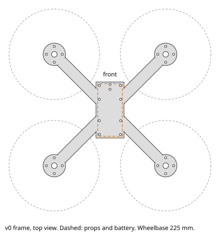

# v0 frame script (Fusion 360 API)

`v0_frame.py` builds the v0 printed 5" X frame in Fusion 360 from a list of numbers. To change the design, edit the numbers and run it again. Each run opens a new design, so old versions are never overwritten.

## What it builds

| Part | Printed? | Notes |
|---|---|---|
| Bottom plate | Yes, PA-CF or PETG-CF | Centre and arms are one piece. 225 mm wheelbase, 5 mm thick |
| Top plate | Yes, PETG-CF | Battery sits on top. Two slots for a 20 mm strap |
| Standoffs (4) | Yes, or buy M3 x 25 mm aluminium | M3 screws pass straight through |
| Camera mount | Yes, TPU | Holds the O4 camera on an M2 pivot so the tilt can be set |
| Reference parts | No | Motors, prop discs, stack and battery as simple shapes, to check fit |

Mounting patterns come from the parts list in `electronics/README.md`: 16 x 16 mm M3 for the Emax ECO II 2207 motors and 30.5 x 30.5 mm M3 for the SpeedyBee F7 V3 stack.

## How to run it

1. Download this folder (`v0_frame`) to your computer. The folder name must stay `v0_frame`.
2. In Fusion 360, open **Utilities > Add-Ins > Scripts and Add-Ins** (or press Shift+S).
3. Click the **+** next to the search box, choose **Script or add-in from device**, and pick the `v0_frame` folder.
4. Select `v0_frame` in the list and click **Run**.
5. A new design opens with the frame, then a message box shows the clearance check.

If something fails, a message box shows the error. Copy that text (or take a screenshot) and send it over so it can be fixed.

## Changing the design

All the numbers are in the `PARAMETERS` block at the top of `v0_frame.py`. Open it in any text editor (or click **Edit** in the Scripts dialog), change a value, save, and run again. For example, try `"bottom_thk": 6.0` for stiffer arms.

To check clearances without opening Fusion, run `python v0_frame.py`. It prints the same check:

| Check | Value | Minimum |
|---|---|---|
| Prop to prop | 29.6 mm | 5 mm |
| Prop to top plate | 6.7 mm | 5 mm |
| Prop to battery | 10.2 mm | 5 mm |
| Bottom plate footprint | 191 x 191 mm | fits the 300 mm bed |

## Exporting for printing

Right-click a body in the browser, choose **Save As Mesh**, and save it as 3MF or STL into `cad/v0.2/`. Hide or skip the reference parts.

## Measure before printing

- O4 camera width (set `cam_width`). It is set to 14 mm as a guess.
- Motor hole spacing and screw length. M3 screws must not touch the motor windings.
