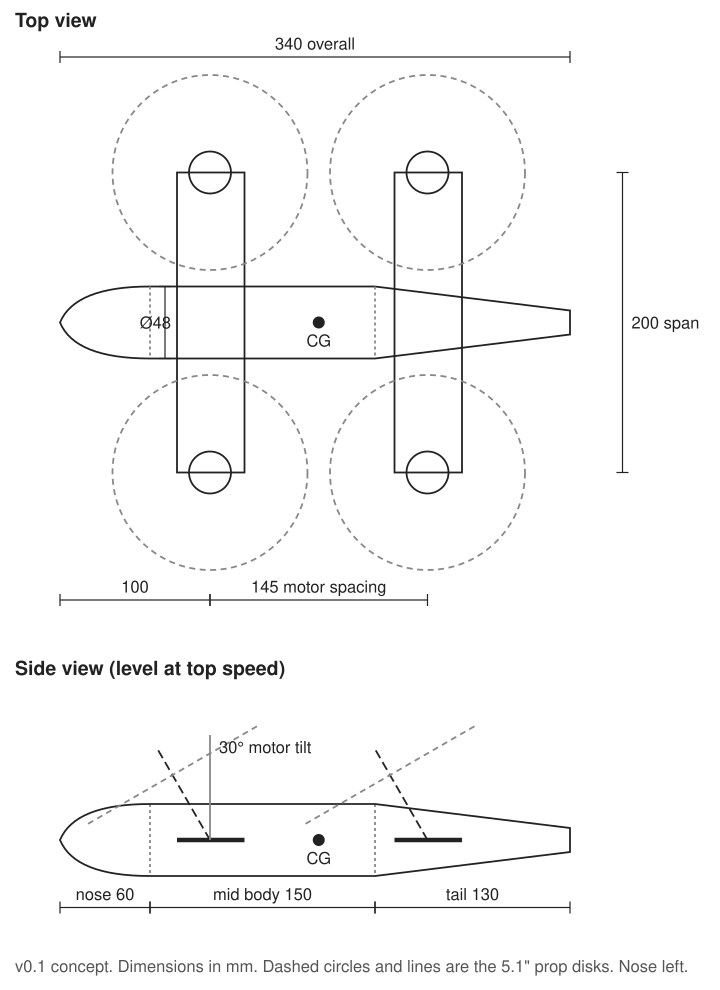

# v0.1 — Concept

**Goal:** Turn the inspiration into a first rocket-body concept with numbers behind it, sized around the v0 electronics.

| | |
|---|---|
| What changed | First version |
| Why | Starting point for the Fusion 360 sketch |
| Result | Predicted 218 km/h (sizing script, `v1` preset). Not built yet |
| Lesson | |

## Fuselage

The body is sized by what goes inside it: the 6S 1300mAh battery (35 x 38 mm) and the 30x30 FC/ESC stack (36 mm boards).

| Dimension | Value | Reason |
|---|---|---|
| Outside diameter | 48 mm | 44 mm inside clears the battery and stack, plus 2 mm walls |
| Length | 340 mm | About 7 times the diameter, a typical low-drag shape |
| Nose | 60 mm | Camera. Separate part so it can be replaced after crashes |
| Mid body | 150 mm | FC/ESC stack, receiver, O4 air unit, then the battery |
| Tail cone | 130 mm | Tapers to 16 mm. Holds the GPS, antennas exit here |

## Motors and wings

| Dimension | Value | Reason |
|---|---|---|
| Motor span (left to right) | 200 mm | Props clear the fuselage by 11 mm |
| Motor spacing (front to back) | 145 mm | Front and rear props clear each other by 15 mm |
| Front wing position | 100 mm from nose tip | Puts the motor centre in the battery bay |
| Wing chord / thickness | 45 mm / 8 mm | Symmetric airfoil (NACA 0018) around a 6 mm carbon tube |
| Motor tilt | 30° forward | Body is level at top speed. See [decision 0002](../../docs/decisions/0002-motor-layout-and-tilt.md) |

The motors sit at the tips of two short wings. A carbon tube runs through each wing and the fuselage to carry the load.

## Mass budget and centre of gravity

| Item | Mass (g) |
|---|---|
| Motors and props | 150 |
| FC, ESC, receiver, GPS, O4 | 45 |
| Wiring, XT60, capacitor | 30 |
| Battery | 215 |
| Printed fuselage | 150 |
| Wings, motor pods, carbon tubes | 100 |
| Nose, screws, inserts | 45 |
| Margin | 115 |
| **Total** | **850** |

The centre of gravity (CG) must sit at the middle of the four motors: 172 mm from the nose tip. The battery is the heaviest part, so it is centred on that point and can slide forward or back a few mm to trim.

## Battery access and crash nose

- Battery goes in through a hatch on top of the mid body, held by a strap.
- The nose is a separate part held by 3 screws, with a soft TPU tip. It is the part expected to break.

## Printing on the K2 Pro

The build volume is 300 x 300 x 300 mm, so the 340 mm body prints in three parts that bolt together with M3 heat-set inserts.

| Part | Material | Why |
|---|---|---|
| Fit-check prints | PLA or PETG | Cheap and quick. Not for flight |
| Nose tip | TPU 95A | Absorbs crash impacts |
| Nose and mid body | PETG-CF | Stiff, easy to print, handles moderate heat |
| Tail cone | Plain PETG | No carbon here, so the GPS and antennas work |
| Wings and motor pods | PA-CF (dried) | Stiffest and most heat resistant, sits next to the motors |

## Next steps

1. Sketch the body in Fusion 360 using these numbers as user parameters (`body_dia`, `motor_span`, `motor_tilt`, ...), so they are easy to change later.
2. Print the mid body in PLA and check the battery and stack fit.
3. Export a screenshot and STEP file to `cad/v0.1/`.
