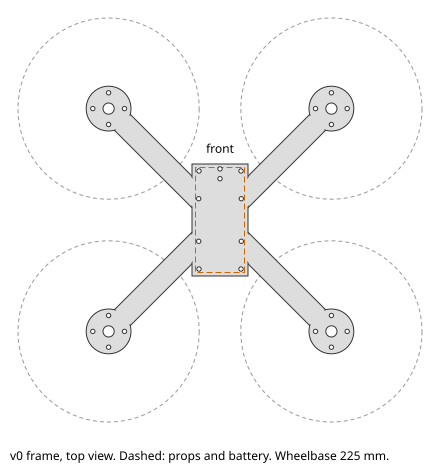

# v0.2 — Printed X frame

**Goal:** A simple printed 5" X frame to fly the v0 electronics on, modelled with a Fusion 360 script.

| | |
|---|---|
| What changed | First frame for the real v0 quad. Modelled from code instead of by hand |
| Why | v0 needs a frame to fly and test the electronics. A script makes each change a small edit that shows up in Git |
| Result | Model script done. Not printed yet |
| Lesson | |

## Main choices

| Choice | Value | Reason |
|---|---|---|
| Layout | True X, 225 mm wheelbase | Standard for 5" props. Leaves about 30 mm between props |
| Bottom plate | One piece, 5 mm thick | No joints to work loose. A broken arm means reprinting the plate (about $3 of filament) |
| Top plate | 80 x 40 mm, 3 mm | Small enough to stay 6.7 mm clear of the props |
| Standoffs | 25 mm | Room for the 30x30 stack and the O4 camera |

Script and run instructions: [cad/v0.2/v0_frame](../../cad/v0.2/v0_frame/README.md)

## Ideas for the next version

- Separate, bolt-on arms if the one-piece plate breaks too often
- Lighter centre section (cut-outs) once the first print proves stiff enough
